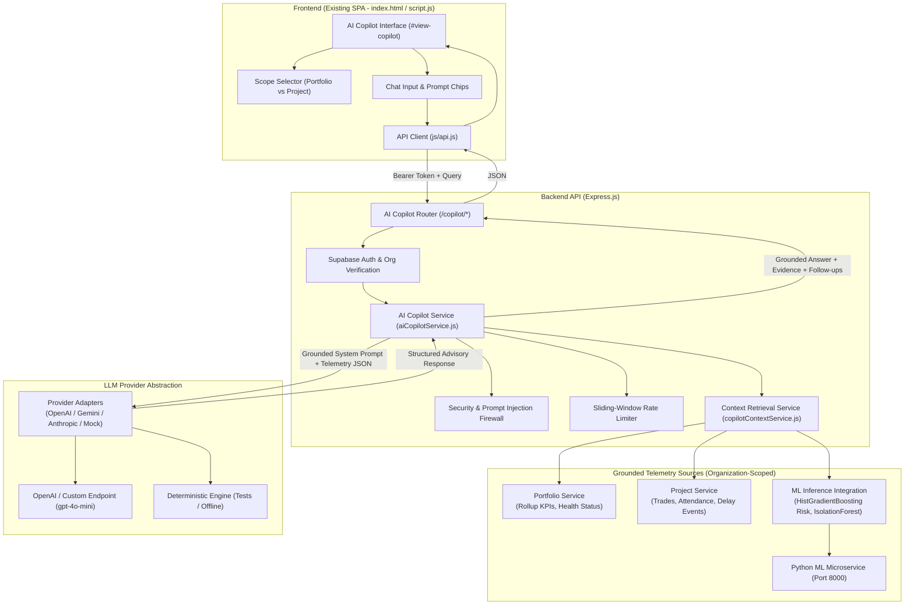

# SitePulse — AI Copilot & Decision Support Architecture

**Version:** 1.0.0  
**Phase:** 6  
**Status:** Implemented & Verified  
**Workspace:** `SitePulse_AIML`  

---

## 1. Executive Overview

The **SitePulse AI Copilot** is a data-grounded, enterprise decision-support engine integrated directly into the existing SitePulse retail construction monitoring platform. 

It enables construction executives, project managers, and site engineers to query live project telemetry, investigate root causes of delays, audit workforce attendance, explain machine learning delay predictions, and receive advisory mitigation recommendations.

### Core Architectural Guarantees:
1. **In-Place Integration:** Fully embedded in the existing application (`index.html`, `script.js`, `style.css`, `backend/src/app.js`). No external standalone demos or disconnected frontends.
2. **Provider Independence:** Pluggable LLM provider abstraction supporting OpenAI, Google Gemini, Anthropic, local/Ollama endpoints, and deterministic mock adapters.
3. **Strict Data Grounding:** Every quantitative claim, date, trade variance, and contractor attribution is retrieved from verified backend services (`portfolioService`, `projectService`, `mlInferenceService`).
4. **Security & Organization Isolation:** Enforces multi-tenant isolation at every query level. Prohibits arbitrary SQL generation, system prompt overrides, and unauthorized data mutations.
5. **Read-Only Advisory Mode:** Operates exclusively as a decision-support advisor. Cannot autonomously alter schedules, cancel contracts, or post unauthorized updates.

---

## 2. End-to-End Architecture & Data Flow

---

## 3. Backend Services & Modules

### 3.1 `backend/src/services/copilotContextService.js`
Responsible for retrieving, filtering, and structuring real-time operational context scoped strictly to `req.user.organizationId`:
- **`getPortfolioContext(orgId, referenceDate)`:**
  - Queries `portfolioService.getPortfolioData()` and `portfolioService.getContractorsData()`.
  - Computes rollup metrics: Active projects, On-Track vs. At-Risk vs. Delayed breakdown, weighted completion %, workforce attendance vs. planned requirement, active delay events, and contractor partner roster.
- **`getProjectContext(projectId, orgId, referenceDate)`:**
  - Queries `projectService.getProjectDashboardData()`.
  - Enriches with store metadata (square footage, brand format, target opening date).
  - Retrieves trade execution table (actual vs planned %, variance, assigned contractor, ratings, workers present).
  - Retrieves active blockers log (`delay_events`).
  - Calls `mlInferenceService` to inject calibrated delay probability, validation threshold (0.5700), top contributing factors, and detected trade anomalies.

### 3.2 `backend/src/services/aiCopilotService.js`
The central orchestration layer managing safety, provider routing, grounding, and response generation:
- **Rate Limiting:** Sliding-window in-memory rate limiter tracking requests per `userId` (max 20 requests per minute).
- **Prompt Injection Defense:** Regex-based adversarial pattern detector that intercepts instruction override attempts (e.g., `ignore previous instructions`, `reveal system prompt`, `drop table`, `grant admin`) and emits a standardized security refusal.
- **Read-Only Guardrail:** Intercepts operational modification requests (e.g., `change progress`, `update deadline`, `cancel contractor`) and explains that Copilot operates in read-only advisory mode.
- **Provider Adapters:**
  - `openai`: Standard Chat Completions API with `model`, `apiKey`, and optional custom `endpoint` (supports OpenAI, Azure, Ollama, vLLM).
  - `gemini`: Google Gemini REST API.
  - `anthropic`: Anthropic Claude Messages API.
  - `mock`: Fully deterministic, grounded rule adapter for automated tests and offline CI environments.
- **Timeout Management:** Uses `AbortController` with configurable timeout (`LLM_TIMEOUT_MS`, default 25,000 ms).
- **Unconfigured State Handling:** If no API key is provided and provider is not mock, returns an explicit `503 LLM_NOT_CONFIGURED` response with setup guidance.

### 3.3 `backend/src/routes/copilot.js`
Exposes authenticated Express routes:
- `GET /copilot/status`: Returns provider configuration, capabilities, and setup instructions.
- `POST /copilot/chat`: Accepts `{ message, projectId, referenceDate, conversationHistory }` and returns grounded decision support.
- `GET /copilot/suggested-prompts`: Returns contextual question chips tailored to portfolio or project scope.

---

## 4. Frontend Single-Page Interface

### 4.1 Subnav & Dedicated View (`index.html`)
- **Navigation Tab:** Added `#tab-nav-copilot` to `.suite-tabs-group` alongside Executive Portfolio, Project Deep Dive, and Trade Analytics.
- **View Container (`#view-copilot`):**
  - **Header Bar:** Interactive Scope Selector (`#copilot-project-select`), provider status badge (`#copilot-provider-badge`), and clear conversation button (`#copilot-clear-chat-btn`).
  - **Unconfigured Banner:** Warning banner displayed if `LLM_API_KEY` is missing, showing exact environment variables required.
  - **Quick Suggestions Bar:** Clickable chips for instant queries (`Which projects are at risk?`, `Workforce shortfall across sites`, `Primary trade bottlenecks`).
  - **Chat Stream Panel:** Auto-scrolling message list with distinct styles for user and assistant bubbles, markdown formatting, data source citations, and follow-up chips.
  - **Typing Indicator:** Animated 3-dot pulse indicator during inference.
  - **Input Area:** Expandable textarea with 1,000-character counter, keyboard submission (`Enter` sends, `Shift+Enter` inserts newline), and advisory disclaimer subtext.

### 4.2 API Client & State Management (`script.js` & `js/api.js`)
- `SitePulseAPI.getCopilotStatus()`
- `SitePulseAPI.sendCopilotMessage()`
- `SitePulseAPI.getSuggestedPrompts()`
- `SitePulseState.copilot`: Maintains `selectedProjectId`, `conversationHistory`, and `isThinking` status.

---

## 5. Configuration & Environment Setup

Configure the AI Copilot via backend environment variables in `.env`:

| Variable | Description | Default | Example |
| :--- | :--- | :--- | :--- |
| `LLM_PROVIDER` | Active LLM provider (`openai`, `gemini`, `anthropic`, `mock`) | `openai` (or `mock` in test mode) | `openai` |
| `LLM_API_KEY` | API key for the selected provider | *None* | `sk-proj-abc123...` |
| `LLM_MODEL` | Target foundation model name | `gpt-4o-mini` | `gpt-4o-mini` |
| `LLM_ENDPOINT` | Optional custom endpoint URL (for Ollama, Azure, or local AI) | Standard Provider URL | `http://localhost:11434/v1/chat/completions` |
| `LLM_TIMEOUT_MS` | Request timeout duration in milliseconds | `25000` | `25000` |

### Provider Specific Fallbacks:
- If `LLM_API_KEY` is not set, the service checks `OPENAI_API_KEY`, `GEMINI_API_KEY`, and `ANTHROPIC_API_KEY`.
- If no key is set and `NODE_ENV !== 'test'`, the Copilot gracefully reports `unconfigured` status without crashing.
