# Construction Progress & Manpower Anomaly Detection Engine
================================================================

## 1. Problem Definition & Operational Motivation

In commercial and retail fitout construction, project monitoring relies heavily on contractor self-reporting and daily site supervisor logs. This creates critical operational vulnerabilities:
1. **Progress Inflation & Implausible Spikes:** Contractors reporting substantial progress jumps to trigger milestone billing payments before physical work is executed.
2. **Phantom Workforce Logging:** Claiming active crew presence on site while workers are either absent, idle, or reallocated to other unapproved job sites.
3. **Unreported Workforce:** Daily progress advancing with zero reported workers, indicating undocumented subcontractor labor, unvetted personnel, or inaccurate record-keeping.
4. **Stagnation Despite Full Staffing:** Extended periods where trades report full staffing but register zero forward progress without an active delay event or client hold.

The objective of the **SitePulse Anomaly Detection Engine** is to identify these anomalies automatically from daily trade logs to prompt timely physical audits before project schedules and budgets are compromised.

---

## 2. Anomaly Taxonomy & Trigger Boundaries

The engine systematically detects four primary anomaly categories across progress and manpower dimensions, with strict semantic distinctions:

| Category | Anomaly Name | Physical Condition & Trigger | Severity | Explanation Template |
| :--- | :--- | :--- | :---: | :--- |
| **Progress** | `implausible_progress_spike` | Single-day progress delta $\ge 14.0\%$. | Critical | *"Daily progress jumped by {delta}%, exceeding single-day physical work capacity limits."* |
| **Manpower** | `phantom_workforce` | $\ge 4$ workers present, delta $\le 0.05\%$, stagnant $\ge 1$ day, without active hold. | Critical | If $w \ge \text{req}$: *"Full workforce ({w}/{req} workers logged) with zero physical progress and no active hold event."*<br>If $w < \text{req}$: *"Active workforce presence ({w} workers logged, required: {req}) with zero physical progress and no active hold event."* |
| **Manpower** | `unreported_workforce` | 0 workers present on site, but daily progress advances $\ge 2.0\%$. | Critical | *"Physical progress increased by {delta}% with zero workers logged on site (unreported crew or inaccurate labor logging)."* |
| **Progress / Manpower** | `stagnant_despite_presence` | Workforce fulfillment $\ge 80\%$, but progress stagnant for $\ge 4$ consecutive days without active hold. | Critical | *"Extended trade stagnation ({st} consecutive days) despite substantial workforce presence ({w}/{req} workers logged)."* |
| **Multivariate** | `unsupervised_statistical` | Atypical multivariate combination of labor shortfall, productivity ratio, and daily velocity. | High / Critical | *"Flagged by multivariate Isolation Forest: statistical outlier across progress and manpower dimensions."* |

---

## 3. Training Protocol: One-Class / Semi-Supervised Baseline

> [!IMPORTANT]
> **Semi-Supervised / One-Class Evaluation Setup:**
> The Isolation Forest was fit strictly on verified normal training observations (`is_anomaly == 0`). Because synthetic ground-truth labels were used to filter out injected anomalies prior to training, this setup constitutes a **one-class / semi-supervised operational baseline**, rather than a completely unsupervised zero-label deployment. The model learns the multidimensional geometry of nominal, uncontaminated fitout operations.

```mermaid
flowchart TD
    A[Daily Trade Log Record] --> B[Feature Engineering Pipeline]
    B --> C[Compute 8 Anomaly Features]
    C --> D[StandardScaler Normalization]
    D --> E[Isolation Forest Decision Function]
    E --> F["Calibrated Sigmoid Score: 1 / (1 + exp(raw * 45))"]
    C --> G[Domain Rule Constraint Evaluator]
    G --> H[Deterministic Rule Score: 0.88 - 0.98]
    F --> I["Score Aggregator: max(S_iso, S_rule)"]
    H --> I
    I --> J{Score >= 0.8900?}
    J -- Yes --> K[Flag as Anomaly: Critical / High Severity]
    J -- No --> L[Mark as Normal: Low / Medium Severity]
```



---

## 4. Feature Engineering

The anomaly detection engine operates on 8 engineered features:
1. `daily_delta_pct`: Daily progress advance in percentage points.
2. `workers_present`: Number of trade workers physically present on site.
3. `workers_required`: Contractually scheduled trade staffing requirement.
4. `shortfall_workers`: Labor deficit ($\max(0, \text{required} - \text{present})$).
5. `productivity_ratio`: Progress delivered per worker ($\text{daily\_delta} / \max(1, \text{workers\_present})$).
6. `consecutive_stagnant`: Consecutive calendar days with progress delta $\le 0.05\%$.
7. `has_active_hold`: Binary flag indicating whether an active delay event or client hold permits physical stoppage.
8. `unexplained_zero_progress`: Indicator for zero progress in the presence of workforce $\ge 4$ without an active hold.

---

## 5. Score Calibration & Sigmoid Mapping

Standard scikit-learn `IsolationForest.decision_function` outputs raw anomaly scores where inliers cluster in positive territory ($+0.10 \text{ to } +0.18$) and outliers fall into negative territory. Using linear score inversion produces an unacceptable false positive rate ($> 10\%$).

To solve this, SitePulse applies a steep logistic sigmoid transformation:
$$S_{\text{iso}}(x) = \frac{1}{1 + e^{45.0 \times \text{raw\_decision}(x)}}$$

This maps:
- Deep inliers ($\text{raw} > +0.10$) $\rightarrow S_{\text{iso}} < 0.01$ (Low severity)
- Neutral boundary ($\text{raw} = 0.00$) $\rightarrow S_{\text{iso}} = 0.50$ (Moderate severity)
- Clear outliers ($\text{raw} < -0.05$) $\rightarrow S_{\text{iso}} > 0.90$ (Critical severity)

Coupled with the domain rules, this calibration reduced false alarms by **98%** while retaining **100% recall**.

---

## 6. Threshold Selection & Severity Bands

The decision threshold was calibrated strictly on the **validation partition** (`val_df`), maximizing F1-score while guaranteeing zero missed critical anomalies:
- **Optimal Decision Threshold:** `0.8900`
- **Severity Bands:**
  - `Low`: $[0.00, 0.45)$ — Nominal operations.
  - `Medium`: $[0.45, 0.65)$ — Minor deviations, no audit required.
  - `High`: $[0.65, 0.85)$ — Significant irregularity, advisory flag.
  - `Critical`: $[0.85, 1.00]$ — Mandatory investigation alert.

---

## 7. Untouched Test Set Evaluation

The hybrid engine was evaluated on the untouched test partition consisting of **8,528 total daily trade observations** (including 42 injected anomalies across 39 projects):

| Metric | Test Set Result | Baseline Uncalibrated Model |
| :--- | :---: | :---: |
| **Total Test Records** | **8,528** | 8,528 |
| **Recall** | **100.00% (42 / 42)** | 92.86% (39 / 42) |
| **Precision** | **64.62%** | 4.30% |
| **F1-Score** | **0.7850** | 0.0822 |
| **PR-AUC** | **0.5401** | 0.0610 |
| **False Positive Rate (FPR)** | **0.27% (23 / 8,486)** | 10.99% |
| **Precision@10** | **20.0%** | 10.0% |
| **Precision@20** | **20.0%** | 8.0% |
| **Precision@50** | **54.0%** | 5.0% |

**Test Confusion Matrix:**
```
                     Predicted Normal    Predicted Anomaly
Actual Normal (8463)       8,463 (TN)             23 (FP)
Actual Anomaly (42)            0 (FN)             42 (TP)
```
- **False Negatives:** **0** — Every genuine anomaly was successfully intercepted.
- **False Positives:** Only 23 records out of 8,486 normal records (0.27% FPR).

---

## 8. API Integration & Explanation Schema

### Request
```http
GET /projects/:id/anomalies
Authorization: Bearer <valid_jwt>
```

### Response Schema (Example: Partial Workforce Presence)
```json
{
  "project_id": "prj-chai-point",
  "project_name": "Cafe Chai Point - Delhi",
  "total_analyzed": 5,
  "anomalies_detected_count": 1,
  "anomalies": [
    {
      "trade_id": "trd-cp-electrical",
      "trade_name": "Electrical",
      "date": "2026-10-01",
      "anomaly_score": 0.95,
      "severity": "Critical",
      "category": "phantom_workforce",
      "explanation": "Active workforce presence (4 workers logged, required: 9) with zero physical progress and no active hold event.",
      "supporting_features": {
        "daily_delta_pct": 0.0,
        "workers_present": 4,
        "workers_required": 9,
        "shortfall_workers": 5,
        "consecutive_stagnant": 1,
        "has_active_hold": 0
      }
    }
  ],
  "model_status": "active",
  "is_experimental_synthetic": true,
  "disclaimer": "Trained on synthetic simulation data for research & prototyping. Not validated for production life-safety or contractual execution."
}
```

---

## 9. Failure Fallback Resilience & Defensive Handling

1. **Service Outage Fallback:** If the Python FastAPI inference service is unreachable or encounters a timeout ($> 1500\text{ms}$), the Express backend automatically switches to `fallback_heuristic` mode via `backend/src/services/mlInferenceService.js`. The fallback engine evaluates identical domain rules locally in JavaScript, ensuring zero service disruption or 500 error cascades.
2. **Defensive History Guardrail:** Real projects with no configured trades or no daily updates return `model_status: "insufficient_history"` rather than hallucinating anomaly predictions.
