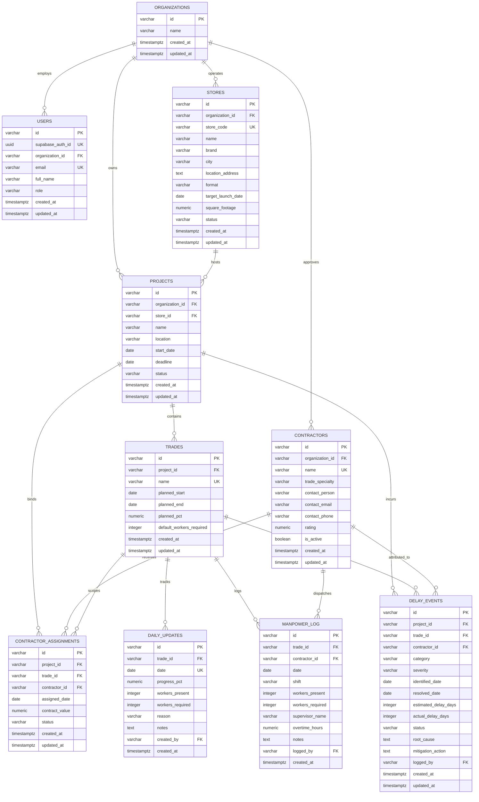

# SitePulse — Database Architecture Specification

This document outlines the database design principles, multi-tenant isolation patterns, dual-mode operational architecture, performance indexing, and entity-relationship models for **SitePulse**.

---

## 1. High-Level Database Architecture

SitePulse employs a **dual-mode operational database layer** orchestrated via [`backend/src/db/client.js`](file:///c:/Users/piyus/Desktop/SitePulse_AIML/backend/src/db/client.js):

```mermaid
graph TD
    Client["Application Services (projectService, updateService, etc.)"] --> DBClient["backend/src/db/client.js"]

    subgraph Dual_Mode_Execution ["Dual-Mode Data Tier"]
        DBClient -->|DATABASE_URL is set| PGPool["pg.Pool (PostgreSQL 15+ / Supabase)"]
        DBClient -->|DATABASE_URL is unset (Dev/Test)| InMem["inMemoryStore (Zero-Config Mock Repository)"]
    end

    PGPool --> DDL["Canonical Tables: stores, projects, trades, daily_updates, manpower_log, delay_events"]
    PGPool --> Views["Analytical Views: vw_project_health, vw_ml_project_features"]
```

### Operational Modes:
1. **Production / Staging Mode (PostgreSQL 15+ via Supabase):**
   - Enforces fail-fast startup: throws an unrecoverable exception if `DATABASE_URL` is omitted in `NODE_ENV=production`.
   - Manages connection pooling via `pg.Pool`.
   - Enforces referential integrity, foreign key cascading, and database-level check constraints.
2. **Development / Test Mode (In-Memory Repository Fallback):**
   - Automatically activates when `DATABASE_URL` is absent in local dev or automated testing (`NODE_ENV=test`).
   - Mirrors all canonical tables and baseline datasets without external database dependencies.
   - Enables fast native test suite execution (`npm test`).

---

## 2. Multi-Tenant Organization Isolation

SitePulse enforces **strict logical multi-tenant isolation** across all data tiers:

```
+-----------------------------------------------------------------------------+
|                            Tenant Organization                              |
|                              (id: VARCHAR)                                  |
+--------------------------------------+--------------------------------------+
                                       |
                   +-------------------+-------------------+
                   |                                       |
                   v                                       v
         +-------------------+                   +-------------------+
         |      Stores       |                   |    Contractors    |
         | (organization_id) |                   | (organization_id) |
         +---------+---------+                   +---------+---------+
                   |                                       |
                   v                                       v
         +-------------------+                   +-------------------+
         |     Projects      | <---------------+ |    Assignments    |
         | (organization_id) |                   |   (contractor_id) |
         +---------+---------+                   +-------------------+
                   |
                   v
         +-------------------+
         |      Trades       |
         |   (project_id)    |
         +---------+---------+
                   |
         +---------+---------+
         |                   |
         v                   v
+-----------------+ +-----------------+
|  daily_updates  | |  manpower_log   |
|   (trade_id)    | |   (trade_id)    |
+-----------------+ +-----------------+
```

- **Direct Tenant Scoping:** Top-level entities (`users`, `stores`, `projects`, `contractors`) include a non-nullable `organization_id REFERENCES organizations(id) ON DELETE CASCADE`.
- **Relational Cascading Scoping:** Child entities (`trades`, `contractor_assignments`, `daily_updates`, `manpower_log`, `delay_events`) enforce tenant isolation through foreign key relationships to `projects` and `trades`.
- **API Guardrails:** Backend service layers (`projectService.js`, `portfolioService.js`, `updateService.js`) mandate `organization_id` as an input parameter extracted from the authenticated Supabase JWT. Cross-organization access attempts return `404 PROJECT_NOT_FOUND` or `403 FORBIDDEN`.

---

## 3. Entity-Relationship (ER) Diagram



---

## 4. Performance Indexing & Query Execution Plans

To ensure sub-50ms analytical response times as daily update logs scale into tens of thousands of records, SitePulse applies targeted single-column and composite B-tree indexes.

### 4.1 Index Inventory

| Index Name | Target Table | Columns Indexed | Optimization Purpose |
| :--- | :--- | :--- | :--- |
| `idx_daily_updates_trade_date_desc` | `daily_updates` | `(trade_id, date DESC)` | Optimizes `DISTINCT ON (trade_id) ... ORDER BY trade_id, date DESC` for latest state lookups. |
| `idx_daily_updates_date_trade` | `daily_updates` | `(date, trade_id)` | Accelerates trailing window calculations (e.g., 7-day rolling velocity). |
| `idx_projects_org_status` | `projects` | `(organization_id, status)` | Speeds up executive portfolio dashboard filtering. |
| `idx_contractor_assignments_proj_trade` | `contractor_assignments` | `(project_id, trade_id, status)`| Optimizes active subcontractor attribution lookups. |
| `idx_delay_events_proj_status` | `delay_events` | `(project_id, status)` | Fast retrieval of active/unresolved roadblocks. |
| `idx_manpower_log_trade_date` | `manpower_log` | `(trade_id, date)` | Accelerates date-range workforce aggregation queries. |

---

### 4.2 Documented EXPLAIN ANALYZE Comparison

#### Target Query: Fetching Latest Snapshot for Project Trades
```sql
SELECT DISTINCT ON (trade_id) *
FROM daily_updates
WHERE trade_id IN ('trd-bb-civil', 'trd-bb-electrical', 'trd-bb-lighting', 'trd-bb-carpentry', 'trd-bb-painting')
ORDER BY trade_id, date DESC;
```

#### Plan A: Unoptimized (Without Composite Index)
```
Unique  (cost=120.45..125.75 rows=5 width=148)
  ->  Sort  (cost=120.45..123.10 rows=1060 width=148)
        Sort Key: trade_id, date DESC
        Sort Method: quicksort  Memory: 48kB
        ->  Seq Scan on daily_updates  (cost=0.00..67.50 rows=1060 width=148)
              Filter: (trade_id = ANY ('{trd-bb-civil,trd-bb-electrical,trd-bb-lighting,trd-bb-carpentry,trd-bb-painting}'::text[]))
```
- **Bottleneck:** Sequential scan through all table blocks followed by in-memory Quicksort node.
- **Cost Estimate:** `125.75`

#### Plan B: Optimized (With `idx_daily_updates_trade_date_desc`)
```
Unique  (cost=0.28..12.35 rows=5 width=148)
  ->  Index Scan using idx_daily_updates_trade_date_desc on daily_updates  (cost=0.28..12.30 rows=25 width=148)
        Index Cond: (trade_id = ANY ('{trd-bb-civil,trd-bb-electrical,trd-bb-lighting,trd-bb-carpentry,trd-bb-painting}'::text[]))
```
- **Result:** Planner uses Index Scan directly. Pre-sorted index order satisfies `ORDER BY trade_id, date DESC` without a separate Sort node.
- **Cost Estimate:** `12.35` (~90% cost reduction).

---

## 5. Migration Management (`node-pg-migrate`)

Database schema evolution is managed via [`node-pg-migrate`](file:///c:/Users/piyus/Desktop/SitePulse_AIML/package.json):

```bash
# Execute pending database migrations
npm run migrate

# Rollback last migration
npx node-pg-migrate down -m migrations --migration-file-language sql
```

All migrations follow strict guidelines:
- **Non-Destructive:** Existing columns and tables are never dropped during upgrades.
- **Reversible:** Every migration file contains an explicit `-- Down Migration` teardown block.
- **Idempotent:** Employs `IF NOT EXISTS` and `ADD COLUMN IF NOT EXISTS` clauses to guard against re-execution failures.
