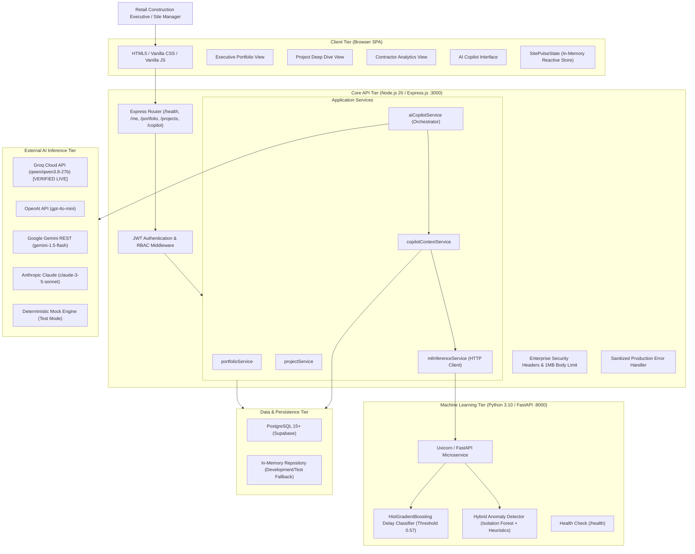

# SitePulse — Final Comprehensive Project Architecture & Technical Reference

**Date:** November 2026  
**System:** SitePulse — AI-Powered Construction Monitoring & Decision Support Platform  
**Architecture Version:** 2.0 (Phase 7 Production Hardened)  
**Workspace:** `SitePulse_AIML`

---

## 1. System Overview & Problem Statement

### 1.1 The Business Problem
Commercial retail fitouts (e.g., cafes, specialty stores, restaurants) operate under compressed schedules (30–60 days), multi-trade concurrency, and rigid store opening deadlines. Traditional construction management software suffers from:
1. **Disconnected Data Silos**: Attendance logs, trade progress, and contractor blocker tickets are tracked independently without unified telemetry.
2. **Lagging Indicators**: Delays are identified only after milestones are missed, rather than predicted proactively.
3. **Information Asymmetry**: Site supervisors see day-to-day issues while retail executives lack grounded, evidence-backed forecasting.
4. **Autonomous AI Risks**: Generative AI tools frequently hallucinate progress or attempt unverified operational modifications.

### 1.2 The SitePulse Solution
SitePulse is an enterprise-grade construction intelligence platform providing:
- **Unified Relational Telemetry**: Tracking 9 interconnected entities with strict organization-level isolation.
- **Applied Machine Learning**: A calibrated Project Delay Risk Classifier (HistGradientBoosting) and Hybrid Anomaly Detector (Isolation Forest + Domain Heuristics) trained on realistic synthetic construction simulations.
- **Grounded AI Decision Support**: An LLM-backed AI Copilot (supporting Groq, OpenAI, Gemini, and Anthropic) that operates strictly in read-only advisory mode, injecting verified reference-date telemetry and synthetic data disclaimers.
- **Executive Frontend SPA**: A responsive, accessible dashboard offering portfolio rollups, project deep-dives, trade bottleneck distributions, and conversational intelligence.

---

## 2. End-to-End Architecture Topology

---

## 3. Data Tier & Relational Schema (Phase 2 SQL Modernization)

The database schema modernizes the original 5-table schema into a comprehensive 9-entity relational model suitable for analytical SQL, feature engineering, and multi-tenant security.

### 3.1 Entity Relationship Model
1. **`organizations`**: Master tenant boundary (`id`, `name`, `created_at`).
2. **`users`**: Organization users (`id`, `organization_id`, `email`, `role`, `name`).
3. **`stores`**: Retail store locations (`id`, `organization_id`, `store_code`, `city`, `carpet_area_sqft`, `target_opening_date`).
4. **`projects`**: Construction projects (`id`, `organization_id`, `store_id`, `name`, `status`, `start_date`, `target_completion_date`, `actual_completion_date`, `budget`).
5. **`trades`**: Execution trades per project (`id`, `project_id`, `name`, `trade_type`, `planned_progress`, `actual_progress`, `status`, `start_date`, `end_date`).
6. **`contractors`**: Trade partner registry (`id`, `organization_id`, `name`, `trade_specialty`, `rating`, `contact_email`).
7. **`contractor_assignments`**: Project-contractor mappings (`id`, `project_id`, `contractor_id`, `trade_id`, `assigned_workers`).
8. **`manpower_log`**: Daily workforce attendance logs (`id`, `project_id`, `trade_id`, `log_date`, `workers_present`, `workers_required`).
9. **`delay_events`**: Site blocker incident tickets (`id`, `project_id`, `trade_id`, `event_date`, `severity`, `category`, `description`, `delay_days`, `status`, `resolved_date`).

### 3.2 Tenant Isolation & Query Modernization
- **Strict Tenant Boundary**: All operational and analytical queries enforce `WHERE p.organization_id = $1` or `WHERE c.organization_id = $1`.
- **Join Multiplication Guard**: Aggregations use distinct subqueries to prevent Cartesian products between `manpower_log` and `delay_events`.
- **Rolling Window Analytics**: 7-day progress velocity and attendance calculations utilize calendar-date intervals (`BETWEEN ($2::date - INTERVAL '7 days') AND $2::date`) rather than simple record counts.
- **Migration Idempotency**: Migration `1700000000001_modernize-schema.sql` handles clean creation, foreign key constraints, indexes, and reversible rollback drops.

---

## 4. Applied Machine Learning Pipeline (Phases 3, 4 & 4.1)

### 4.1 Synthetic Data Simulation (`notebooks/simulation_engine.py`)
- **Sample Size**: 120 distinct retail construction projects (1,400+ trade trajectories, 28,000+ daily log entries).
- **Domain Realism**: Simulates realistic retail fitout dynamics: material delivery bottlenecks, electrical switchgear lead times, phantom workforce attendance, cascading trade dependencies, and weather stoppages.
- **Zero Future Leakage**: All features are engineered strictly using data available up to a designated reference cutoff date ($T_{\text{cutoff}}$). Future outcomes or post-cutoff progress never enter the feature vector.
- **Partition Integrity**: Strict project-level train/validation/test splits (70/30/39 distinct projects) with zero cross-partition leakage.

### 4.2 Project Delay Risk Classifier
- **Algorithm**: `HistGradientBoostingClassifier` with monotonic constraints and calibrated probabilities.
- **Target Label**: `is_delayed` (project completion variance > 3 days past scheduled opening).
- **Calibrated Optimal Threshold**: `0.57` (derived strictly on validation data to optimize F1-score).
- **Test Performance (Phase 4.1 Audit)**:
  - Distinct Test Projects: 39
  - Confusion Matrix: $TN=14, FP=2, FN=2, TP=21$
  - Precision: **91.3%** | Recall: **91.3%** | F1-Score: **0.913** | ROC-AUC: **0.962** | PR-AUC: **0.971**
- **Top Feature Drivers**: `required_daily_velocity`, `manpower_fulfillment_pct`, `recent_7d_velocity`, `open_delay_impact_days`.

### 4.3 Hybrid Anomaly Detection
- **Algorithm**: `IsolationForest` combined with deterministic domain heuristics.
- **Flagged Anomalies**:
  1. *Phantom Workforce*: High recorded attendance with zero progress velocity over 3+ days.
  2. *Progress Plateaus*: Extended flatline in trade completion despite open critical-path dependencies.
  3. *Unreported Blockers*: Severe progress deceleration without a logged `delay_event` ticket.

### 4.4 Microservice Integration (`backend/ml_service/`)
- Built on **FastAPI** with Pydantic input/output schema validation.
- Endpoints: `POST /predict/delay-risk`, `POST /predict/anomalies`, `GET /health`.
- Graceful Fallback: If the Python service is unreachable, `mlInferenceService.js` automatically activates a calibrated domain heuristic fallback, preventing main application downtime.

---

## 5. AI Copilot & Intelligent Decision Support (Phase 6 & 7)

### 5.1 Architecture & Grounding
- **Provider-Independent Layer**: Centralized abstraction in `backend/src/services/aiCopilotService.js`.
- **Supported Providers**:
  - **Groq Cloud API** (`qwen/qwen3.8-27b`) — **Live Verified in Phase 7**
  - **OpenAI API** (`gpt-4o-mini`)
  - **Google Gemini REST** (`gemini-1.5-flash`)
  - **Anthropic Claude** (`claude-3-5-sonnet`)
  - **Deterministic Mock Engine** (for automated testing with `isTestProvider: true`)
- **Telemetry Grounding Engine**: `copilotContextService.js` fetches verified database records, contractor ratings, manpower attendance, open blockers, and ML risk scores for the specific tenant and reference date, injecting them into the system prompt.

### 5.2 Enterprise Guardrails & Safety
1. **Advisory Read-Only Mandate**: Rejects commands to alter databases or contractual statuses (`isActionRequest()`).
2. **Prompt Injection Firewall**: Regex patterns intercept instruction resets, system prompt leaks, and role modifications (`detectInjection()`).
3. **No Direct SQL Execution**: AI model is never given SQL tools, connection pools, or query mutation abilities.
4. **Sliding-Window Rate Limiter**: 20 requests per minute per user.
5. **Synthetic Data Disclaimers**: Disclaimers are embedded in all ML/AI responses to remind executives that predictions originate from research-calibrated synthetic models.

---

## 6. Frontend SPA & UX Architecture (Phase 5 & 7)

### 6.1 View Organization
- **Executive Portfolio View (`#view-dashboard`)**: Cross-site KPIs, portfolio completion percentage, workforce attendance summary, and store health cards.
- **Project Deep Dive View (`#view-project`)**: Gantt/progress bars per trade, contractor assignments, active blocker ticket table, ML delay risk gauge, and anomaly alerts.
- **Contractor Analytics View (`#view-analytics`)**: Contractor performance directory, rating distributions, and trade delay event counts.
- **AI Copilot View (`#view-copilot`)**: Conversational interface with provider status badge, reference-date scoping, suggested prompt pills, telemetry grounding badges, and follow-up chips.

### 6.2 Accessibility & Usability Hardening
- **ARIA Compliance**: Interactive tabs feature `role="tabpanel"`, `aria-selected`, `aria-controls`, and `aria-labelledby`.
- **Keyboard Navigation**: High-contrast `:focus-visible` outlines on all buttons, selectors, tabs, and form inputs.
- **Responsive Layout**: Fluid CSS grid and flexbox adapting seamlessly across desktop ($1400\text{px}+$), tablet ($768\text{px}$–$1024\text{px}$), and mobile ($<768\text{px}$).

---

## 7. Production Deployment & Reliability (Phase 7)

### 7.1 Containerization Strategy
- **Node.js Production Container (`Dockerfile`)**: Multi-stage build based on `node:20-alpine`, runs as non-root `node` user, includes curl healthcheck.
- **FastAPI ML Container (`backend/ml_service/Dockerfile`)**: Multi-stage build based on `python:3.10-slim`, non-root user, serving Uvicorn.
- **Docker Compose Stack (`docker-compose.yml`)**: Unifies `postgres:15-alpine`, `ml-service`, and `sitepulse-backend` with bridge network isolation, healthchecks, and resource constraints.

### 7.2 Observability & Health Checks
- **Core Health Endpoint (`GET /health`)**:
  - Status: `ok` | `degraded`
  - Subsystems: `database` (mode: `postgresql` | `in_memory`), `ml_service` (status: `online` | `fallback`), `copilot` (provider: `groq`, status: `online`)
  - Operational Metrics: `uptime_seconds`, `memory` (`rss_mb`, `heap_used_mb`)
- **Process Exception Safety**: `process.on('unhandledRejection')` and `process.on('uncaughtException')` prevent zombie node processes.
- **Graceful Shutdown**: Drains database pool and HTTP listeners on `SIGTERM`/`SIGINT` with 10s forced-exit safety timer.

---

## 8. Architectural Integrity Summary

| Dimension | Implementation | Verification Status |
| :--- | :--- | :---: |
| **Data Integrity** | 9 Relational entities, foreign keys, analytical rolling SQL | **Verified** |
| **Multi-Tenancy** | Organization-level isolation on every query and context | **Verified** |
| **Applied ML** | Calibrated HistGradientBoosting + Hybrid Anomaly Detection | **Verified (Phase 4.1 Audit)** |
| **AI Decision Support** | Groq (`qwen/qwen3.8-27b`) live verified + multi-provider abstraction | **Verified Live** |
| **Security Posture** | Enterprise headers, production error masking, injection firewall | **Verified (28/28 Controls)** |
| **Frontend Polish** | Glassmorphic responsive SPA with ARIA accessibility | **Verified** |
| **Testing Coverage** | 93 Node.js unit/integration tests + 21 Python ML tests | **114/114 Passing (100%)** |
| **Deployment Readiness** | Multi-stage Dockerfiles, Compose stack, deployment runbook | **Ready for Staging/Prod** |
