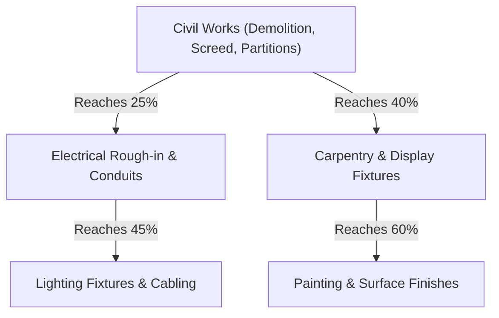

# SitePulse — Synthetic Data Simulation Methodology
**Phase 3: Multi-Trade Construction Project Trajectory Generator**
*Document Version: 1.0.0 | Status: Production Benchmark*

---

> [!IMPORTANT]
> **Data Integrity Notice & Disclaimer**  
> All datasets generated by the SitePulse simulation engine are **synthetic simulations** engineered specifically for offline machine learning model development, pipeline verification, and algorithm benchmarking. While parameterized using commercial retail fitout domain constraints, **they do not represent real-world customer deployments, actual brand confidential schedules, or empirical industry ground truth.**

---

## 1. Domain Simulation Assumptions

Commercial interior retail fitouts (e.g. coffee shops, quick-service restaurants, lifestyle apparel stores) typically span **35 to 55 calendar days**. Execution on site follows physical construction precedence, parallel trade execution, and non-linear productivity curves.

### 1.1 Physical Trade Sequence & Dependencies
SitePulse models **5 critical fitout trades** with explicit milestone unlock thresholds:

| Sequence | Trade Name | Weight | Crew Size (Nominal) | Productivity Factor | Dependency Prerequisite | Unlock Threshold |
| :---: | :--- | :---: | :---: | :---: | :--- | :---: |
| 1 | **Civil** | 0.25 | 12 workers | 0.42% / worker-day | None (Starts Day 1) | 0.0% |
| 2 | **Electrical** | 0.25 | 8 workers | 0.56% / worker-day | Civil | 25.0% |
| 3 | **Lighting** | 0.15 | 6 workers | 1.04% / worker-day | Electrical | 45.0% |
| 4 | **Carpentry** | 0.20 | 10 workers | 0.45% / worker-day | Civil | 40.0% |
| 5 | **Painting** | 0.15 | 5 workers | 1.25% / worker-day | Carpentry | 60.0% |



### 1.2 Daily Progress Calculation
For an unblocked trade on day $t$, daily progress percentage delta $\Delta P_{t}$ is calculated as:
$$\Delta P_{t} = \max\left(0.0, \text{round}\left(W_{present} \times \phi_{trade} \times \left(\frac{R_{contractor}}{4.0}\right) \times \epsilon_{noise}, 2\right)\right)$$

Where:
- $W_{present}$: Daily actual workforce present on site.
- $\phi_{trade}$: Baseline trade productivity factor (% progress per worker-day).
- $R_{contractor}$: Assigned contractor rating ($3.5 \le R \le 4.7$, benchmarked to 4.0).
- $\epsilon_{noise} \sim \text{Uniform}(0.90, 1.10)$: Stochastic daily productivity variance.

### 1.3 Planned Progress (S-Curve) Baseline
Project planned progress follows a standard sigmoidal cumulative S-curve:
$$P_{planned}(t) = \frac{100}{1 + \exp\left(-9.0 \times \left(t_{norm} - 0.48\right)\right)}$$
Adjusted by trade sequence delays ($seq\_delay = (seq - 1) \times 0.12$) to model scheduled lag between sequential packages.

---

## 2. Operational Scenario Distributions

The engine generates **260 distinct projects** systematically distributed across **8 real-world construction scenarios**:

| Scenario Key | Distribution | Operational Behavior | Target Delay Profile |
| :--- | :---: | :--- | :--- |
| `on_schedule` | 12.7% (33) | Smooth execution with nominal staffing ($\sim 98\%$) and minor variance. | On schedule or ahead ($-4 \dots +3$ days) |
| `manpower_delay` | 12.7% (33) | Chronic labor shortage starting at 20% timeline; staffing drops to $40-70\%$. | Severe delay ($+20 \dots +40$ days) |
| `material_delay` | 12.7% (33) | Switchgear or laminate supply stockout holding trade for $8-14$ days. | Moderate delay ($+5 \dots +14$ days) |
| `approval_bottleneck` | 12.7% (33) | Mall management or client design freeze halting civil rough-in for $7-12$ days. | Moderate delay ($+6 \dots +14$ days) |
| `concurrent_delays` | 12.3% (32) | Compound failures: material stockout + labor shortage + $12\%$ carpentry rework. | Extreme delay ($+20 \dots +42$ days) |
| `recovery_intervention`| 12.3% (32) | Slips early; at 50% timeline, contractor mobilizes workforce surge ($+6$ workers). | Schedule recovered ($-16 \dots +2$ days) |
| `misleading_reporting` | 12.3% (32) | Phantom workforce and inflated progress reported; corrected upon site audit. | Slippage exposed ($+6 \dots +18$ days) |
| `workforce_fluctuations`| 12.3% (32) | Seasonal/festival absenteeism; attendance drops to $30\%$ for 8 days. | Minor-moderate delay ($+4 \dots +12$ days) |

---

## 3. Synthetic Anomaly Injection Mechanics

For anomaly detection model preparation, controlled anomalies are injected within the `misleading_reporting` scenario:

1. **Phantom Workforce (`phantom_workforce`):**
   - *Pattern:* Full or elevated manpower attendance reported ($W_{present} \ge W_{req}$), but progress delta is strictly $0.0\%$.
   - *Frequency:* Days 18 to 22 in Carpentry package.
2. **Implausible Progress Spike (`implausible_progress_spike`):**
   - *Pattern:* Progress jumps by $+18.0\%$ in a single 24-hour shift, exceeding physical curing and installation feasibility.
   - *Frequency:* Day 28 in Civil package.
3. **Unreported Workforce (`unreported_workforce`):**
   - *Pattern:* Significant progress delta ($+8.5\%$) recorded despite $0$ workers present logged on site.
   - *Frequency:* Day 15 in Painting package.

---

## 4. Referential Integrity & Relational Architecture

Every generated entity maintains strict foreign key relationships matching the modernized PostgreSQL schema:
- `stores (id)` $\leftarrow$ `projects (store_id)`
- `projects (id)` $\leftarrow$ `trades (project_id)`
- `trades (id)` $\leftarrow$ `daily_updates (trade_id)`
- `trades (id)` & `contractors (id)` $\leftarrow$ `manpower_log (trade_id, contractor_id)`
- `projects (id)` & `trades (id)` $\leftarrow$ `delay_events (project_id, trade_id)`

All generated rows contain `"is_synthetic": True` to guarantee total separation from production data.

---

## 5. Dataset Reproduction Guide

To reproduce the exact synthetic dataset from scratch:

```bash
# From workspace root
python notebooks/simulation_engine.py
```

Generated outputs in `data/synthetic/`:
- `projects.csv` (260 rows)
- `stores.csv` (260 rows)
- `trades.csv` (1,300 rows)
- `daily_updates.csv` (56,797 rows)
- `manpower_log.csv` (56,797 rows)
- `contractor_assignments.csv` (1,300 rows)
- `delay_events.csv` (130 rows)
- `consolidated_trajectories.csv` (56,797 rows)
- `project_features_day25.csv` (260 rows)
- `trade_features_day25.csv` (1,300 rows)
- `train_features.csv`, `val_features.csv`, `test_features.csv`
- `train_trade_features.csv`, `val_trade_features.csv`, `test_trade_features.csv`
- `split_metadata.json`

---

## 6. Known Dataset Limitations

1. **Homogeneous Fitout Typology:** The current simulation models retail interior fitouts ($1,200 - 4,500$ sq.ft.). Industrial warehouses and base-build civil structures with multi-year timelines are not represented.
2. **Single Primary Shift:** Manpower logs model a dominant single day-shift with optional overtime during recovery, rather than 24/7 continuous rotational shifts.
3. **Discrete Step Resolution:** Updates are discretized at 1-calendar-day intervals. Hourly sensor telematics are not included.
