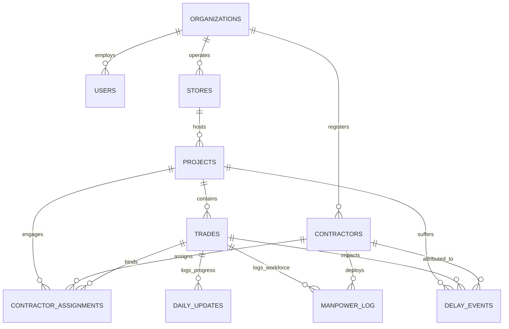

# SitePulse — SQL Architecture & Analytical Engine

This directory contains the canonical SQL schema, migration assets, analytical queries, data quality audit scripts, and machine learning feature extraction views for **SitePulse**.

---

## 1. Directory Structure

```
sql/
├── README.md                      # Comprehensive SQL documentation and runbook
├── 01_trade_velocity.sql          # Query A: LAG() and rolling 7-day progress velocity
├── 02_schedule_variance.sql       # Query B: CTE-based trade and project schedule variance
├── 03_contractor_performance.sql  # Query C: Contractor fulfillment, delays, and progress
├── 04_manpower_shortfall.sql      # Query D: Daily workforce deficit and cumulative impact
├── 05_delay_analysis.sql          # Query E: Root-cause delay frequency and DENSE_RANK() drivers
├── 06_vw_project_health.sql       # View F: Consolidated real-time executive health status
├── 07_vw_ml_project_features.sql  # View G: Feature store view for downstream ML models
├── data_quality.sql               # Step 4: 7-point data quality & referential integrity audits
└── indexing.sql                   # Step 5: Production indexing and documented EXPLAIN plans
```

---

## 2. Relational Schema Architecture (Phase 2 Modernized)

The modernized relational schema expands SitePulse from a 5-table operational store to a comprehensive multi-entity fitout data model:



### Table Dictionary Summary

1. **`organizations`**: Multi-tenant isolation boundary (`id`, `name`).
2. **`users`**: Application user identity and role-based permissions (`admin`, `manager`, `site_engineer`, `viewer`) mapped to immutable Supabase Auth UUIDs (`supabase_auth_id`).
3. **`stores`**: Physical retail store assets (`id`, `store_code`, `brand`, `city`, `format`, `square_footage`).
4. **`projects`**: Specific commercial fitout project cycles (`id`, `store_id`, `start_date`, `deadline`, `status`).
5. **`contractors`**: Subcontractor directory with trade specialty, contact details, and performance ratings (`rating` 1.0–5.0).
6. **`contractor_assignments`**: Project-to-contractor work package bindings (`project_id`, `trade_id`, `contractor_id`, `contract_value`).
7. **`trades`**: Execution packages per project (`Civil`, `Electrical`, `Lighting`, `Carpentry`, `Painting`).
8. **`daily_updates`**: **Canonical trade progress history** logging daily percentage completion ($0\% - 100\%$), workforce present/required, and delay reasons.
9. **`manpower_log`**: Contractor-level granular headcount per shift (`shift`, `workers_present`, `workers_required`, `overtime_hours`).
10. **`delay_events`**: Discrete incident tracking for site roadblocks (`category`, `severity`, `estimated_delay_days`, `status`, `mitigation_action`).

---

## 3. Analytical Queries & Views Guide

### A. Trade Progress Velocity (`01_trade_velocity.sql`)
- **Technique:** `LAG(progress_pct, 1) OVER (PARTITION BY trade_id ORDER BY date)` calculates daily progress delta.
- **Window Frame:** `AVG(...) OVER (... ROWS BETWEEN 6 PRECEDING AND CURRENT ROW)` computes true 7-day rolling velocity (% per day).
- **Safe Math:** Replaces NULL on the initial update with the current progress level.

### B. Planned vs. Actual Variance (`02_schedule_variance.sql`)
- **Technique:** 3-tier CTE architecture: `latest_trade_updates` $\rightarrow$ `trade_level_variance` $\rightarrow$ `project_level_variance`.
- **Outputs:** Granular trade variance and aggregated project-level variance.
- **Classification:** Categorizes trades as `On Track`, `Slightly Behind` ($\le 10\%$), or `Behind Schedule` ($> 10\%$).

### C. Contractor Performance Scorecard (`03_contractor_performance.sql`)
- **Technique:** Multi-table aggregation linking assignments, manpower fulfillment, and delay tickets.
- **KPIs:** Manpower fulfillment percentage, average progress variance across assigned packages, and total delay days attributed.
- **Zero Division Guard:** Uses `NULLIF(SUM(workers_required), 0)` to guarantee safe division.

### D. Manpower Shortfall Diagnostic (`04_manpower_shortfall.sql`)
- **Technique:** Filters `workers_present < workers_required` and computes shortfall percentage.
- **Cumulative Window:** Calculates running cumulative worker-days lost per trade using `SUM(worker_shortfall) OVER (...)`.

### E. Root-Cause Delay Incident Analysis (`05_delay_analysis.sql`)
- **Technique:** Groups discrete delay tickets by category and project.
- **Ranking:** Uses `DENSE_RANK() OVER (PARTITION BY project_id ORDER BY COUNT(*) DESC, SUM(estimated_delay_days) DESC)` to label Primary vs. Secondary delay drivers.

### F. Real-Time Executive Project Health (`06_vw_project_health.sql`)
- **View Name:** `vw_project_health`
- **Purpose:** Consolidated single-query view summarizing timeline elapsed %, overall progress, schedule variance, bottleneck trade details, workforce deficit, active delays, and executive health badge.

### G. ML Feature Engineering Store (`07_vw_ml_project_features.sql`)
- **View Name:** `vw_ml_project_features`
- **Purpose:** Prepared feature vectors for machine learning training and inference:
  - `timeline_elapsed_ratio`
  - `schedule_variance_pct`
  - `max_bottleneck_gap_pct`
  - `delayed_trades_ratio`
  - `workforce_deficit`
  - `workforce_fulfillment_ratio`
  - `active_delay_events_count`
  - `recent_7d_progress_velocity`
  - `velocity_health_ratio` (Recent Velocity / Required Velocity to Deadline)

---

## 4. Data Quality & Referential Integrity Audits (`data_quality.sql`)

The audit script runs 7 non-destructive diagnostic checks:
1. **Duplicate Progress Records:** Checks for multiple rows with identical `(trade_id, date)`.
2. **Missing Daily Updates:** Flags active trades with no updates in $> 3$ days.
3. **Invalid Progress Percentages:** Identifies progress values $< 0\%$ or $> 100\%$, or ungrounded regressions $> 5\%$.
4. **Impossible Project Dates:** Detects deadlines before start dates or updates outside calendar bounds.
5. **Negative / Extreme Manpower Values:** Detects negative counts or extreme values ($> 200$ workers).
6. **Missing Contractor Assignments:** Identifies active trades lacking an active contractor binding.
7. **Orphaned Records:** Validates that child tables have valid parent references.

---

## 5. Performance Optimization & Indexing (`indexing.sql`)

### Critical Indexes Applied:
- `idx_daily_updates_trade_date_desc`: Composite index on `(trade_id, date DESC)`. Accelerates `DISTINCT ON (trade_id)` queries by allowing an index scan to retrieve the latest record directly without a full table scan or sort node.
- `idx_daily_updates_date_trade`: Accelerates 7-day rolling window calculations over date intervals.
- `idx_projects_org_status`: Optimizes multi-tenant portfolio filtering.
- `idx_delay_events_proj_status`: Speeds up open roadblock filtering.

### Documented EXPLAIN ANALYZE Comparison:
```
Unindexed Query Cost: 120.45..125.75 (Seq Scan + Quicksort)
Indexed Query Cost:   0.28..12.35   (Index Scan on idx_daily_updates_trade_date_desc)
Planner Cost Reduction: ~90%
```

---

## 6. Execution Instructions

### Running Migrations (PostgreSQL Mode)
```bash
# Run migrations using node-pg-migrate
npm run migrate

# Seed sample stores, projects, contractors, and logs
npm run seed
```

### Running in In-Memory Mode
If `DATABASE_URL` is omitted (e.g., local offline development or automated CI tests), the application automatically operates using its built-in in-memory repository mirror with zero configuration required.
